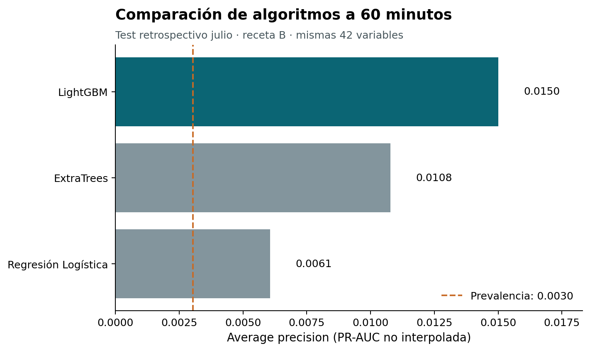

# Proyecto

**Predicción temprana de Efectos Anódicos mediante Machine Learning.**

## Objetivo

Anticipar el inicio de un Efecto Anódico (EA) en un proceso industrial.
Utilizar mediciones eléctricas y su evolución reciente para estimar el riesgo.
Comparar tres algoritmos de clasificación con un horizonte de 60 minutos.
Medir los episodios detectados, la anticipación y la cantidad de falsas alertas.
Evaluar la utilidad potencial de las alarmas antes de una aplicación operativa.

## Datos

El estudio comprende **384 cubas**, registros aproximadamente cada **cinco minutos**
y el período **enero–julio de 2026**.

Los datos utilizados pertenecen a un proceso industrial real y no se incluyen en el repositorio por razones de confidencialidad.

Se publican únicamente resultados agregados. El modo `--demo` genera datos sintéticos
para ejecutar todo el flujo; **sus resultados no son los resultados industriales**.

## Metodología

- Entrenamiento: enero–mayo; validación: junio; evaluación retrospectiva: julio.
  Se excluyen los últimos 60 minutos de entrenamiento y validación para evitar cruces de etiquetas.
- 42 variables conservadoras (receta B en las figuras): corriente, tensión, resistencia, estadísticas de ventanas de 15–480 minutos,
  diferencias, edad de los retardos, huecos de medición y calendario cíclico.
  Las ventanas incluyen el presente y sólo miran hacia atrás. Los identificadores y eventos no son predictores.
- Regresión Logística, ExtraTrees y LightGBM. Imputación y escalado se ajustan sólo con entrenamiento.
  Se utilizan todos los positivos y un 2 % determinista de negativos con peso 50; semilla `20260825`.
- Modelo seleccionado por mayor PR-AUC de junio; umbral por mayor F1 de junio, sin reajustar con julio.
  PR-AUC significa *average precision*. También se calculan ROC-AUC, precision, recall y F1.
- Etiqueta: inicio de EA en `(t, t+60 min]`. Se filtran paradas, señales esenciales faltantes,
  huecos recientes mayores de 30 minutos y eventos conocidos hasta 30 minutos después de su fin.
- Evaluación por fila y por episodio: cada EA recibe un único crédito por detección;
  la anticipación se mide desde la primera alerta válida. Todos los EA integran el denominador.
- Cooldown de **30 minutos por cuba**, contado desde la última alerta emitida.
  Se compara también con cooldown cero. Cada alerta se asigna sólo al siguiente EA;
  la carga diaria usa los 31 días de julio y abarca el conjunto de cubas.

## Resultados principales

Resultados del estudio real con el modelo seleccionado y cooldown de 30 minutos:

| Indicador | Resultado |
|---|---:|
| Modelo | LightGBM |
| Horizonte | 60 min |
| Recall por episodio | 27,57 % |
| Anticipación mediana entre episodios detectados | 17,17 min |
| Alertas por día | 229 |
| Falsas alertas por día | 219,87 |

Son **resultados retrospectivos**. Julio ya había sido explorado durante el desarrollo;
no es una prueba completamente virgen. Los inicios de EA de julio se estimaron mediante
un proxy, con incertidumbre de aproximadamente ±10 minutos. El modelo requiere mejoras
antes de una aplicación operativa, especialmente por la carga de falsas alertas.

Las tres tablas de `results/` comparan los algoritmos a 60 minutos y las políticas de cooldown.
Las cuatro figuras de `figures/` corresponden al estudio real, no a la demostración.



## Ejecución

Desde la carpeta del repositorio, con **Python 3.12**:

```bash
pip install -r requirements.txt
python proyecto_final_ea.py --demo
```

El comando entrena los tres modelos, selecciona en junio, evalúa julio y genera tres CSV,
cuatro figuras y `seleccion.json` en `outputs/demo/`. Las tablas y figuras publicadas se conservan.
La demostración puede elegir otro algoritmo porque sus datos son artificiales.

Para ejecutar con datos privados normalizados, guardar los dos CSV en `data/`:

| Archivo | Columnas obligatorias |
|---|---|
| `mediciones.csv` | `timestamp`, `unit_id`, `current`, `voltage`, `resistance`, `is_shutdown` |
| `episodios.csv` | `event_id`, `unit_id`, `start`, `end`, `observed_at` |

`unit_id` identifica la misma cuba en ambos archivos; `event_id` identifica un episodio único.
Usar fechas ISO sin zona horaria, en una misma hora local; `is_shutdown` vale 0 o 1.
Las señales son numéricas, con unidades consistentes durante todo el período y faltantes vacíos.
No se interpolan mediciones ni se aceptan duplicados de cuba–fecha o de episodio.
`observed_at` es el momento en que el evento pudo conocerse: no debe adelantarse al inicio real
para reproducir retrospectivamente una señal que aún no estaba disponible.
Los episodios deben cubrir hasta **2026-08-01 01:00:00**, para evaluar la última hora de julio.
La extracción desde los sistemas industriales y la construcción de sus etiquetas se realizan de forma privada.

```bash
python proyecto_final_ea.py --measurements data/mediciones.csv --events data/episodios.csv --outcome-end "2026-08-01 01:00:00"
```

La salida privada queda en `outputs/local/`. `data/` y `outputs/` están excluidas de Git.
El procesamiento mensual utiliza almacenamiento temporal; una ejecución industrial necesita más
tiempo y espacio que la demostración. El programa no requiere conexión a sistemas industriales.
Sin los datos privados no pueden recalcularse exactamente los números publicados.
Cambiar los identificadores cambia el submuestreo determinista de entrenamiento.

## Autor

Diego Lapitz

Diplomatura en Ciencia de Datos y Análisis Avanzado — UTN
